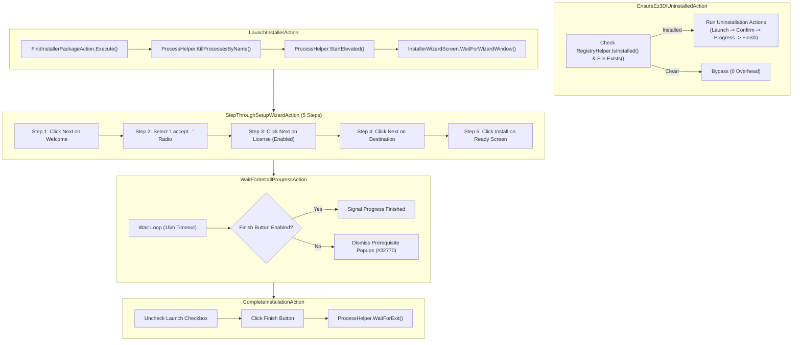
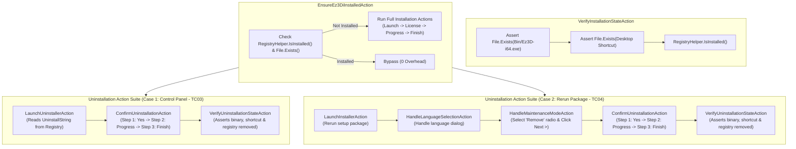
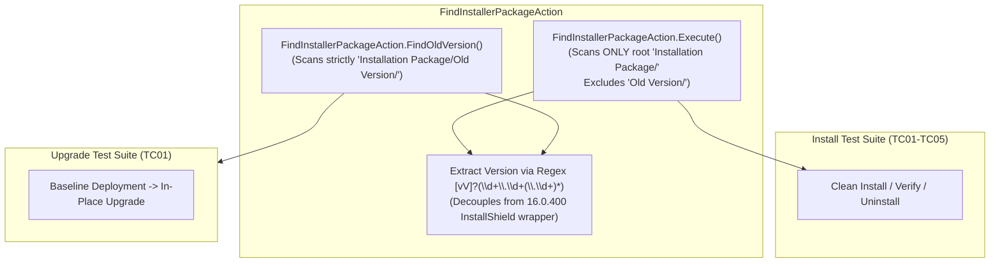
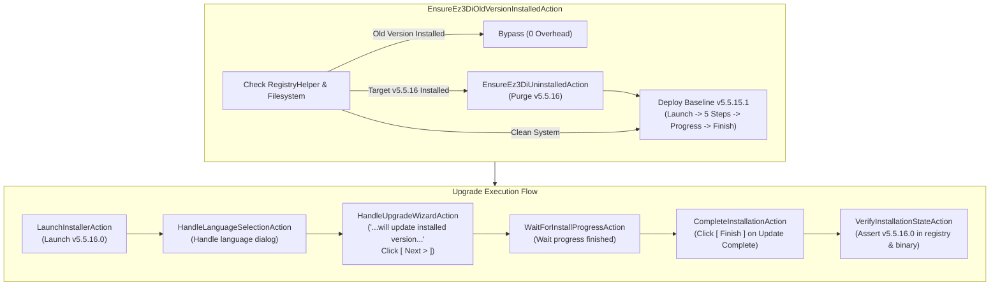
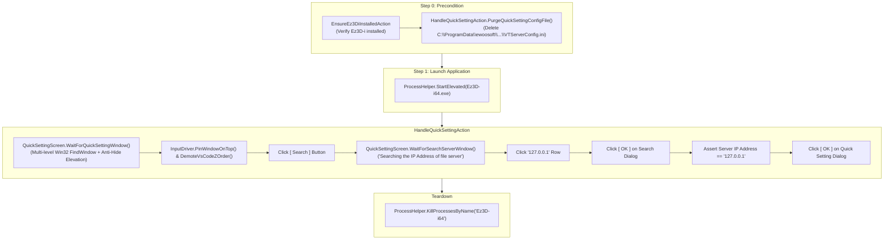

# Ez3D-i.Installer — Action Call Hierarchy

Detailed call hierarchies and execution flow diagrams for all Action implementations.

---

## 1. Installation Flow

---

## 2. Uninstallation & Verification Flow

---

## 3. Package Discovery & Upgrade Isolation Flow

---

## 4. In-Place Upgrade Execution Flow (`TC01_InPlace_Upgrade`)

---

## 5. Quick Setting Execution Flow (`TC06_Quick_Setting`)

