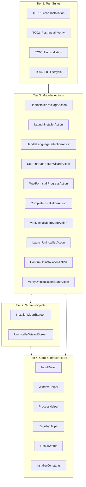

# Ez3D-i.Installer — Architecture Graph

## 1. 4-Tier Architectural Hierarchy

---

## 2. Layer Responsibilities & Isolation Boundaries

1. **Tier 1 (Tests):**
   - Pure orchestration and assertions. No direct Win32 P/Invoke or low-level FlaUI automation element calls.
   - All tests inherit from [`BaseInstallerFixture`](file:///d:/Ez3D-i.Installer/Tests/BaseInstallerFixture.cs).

2. **Tier 2 (Screens):**
   - Responsible for locating UI elements within the InstallShield dialog (`#32770`) without business logic.
   - Wraps FlaUI UIA3 element queries with timeout tolerance.

3. **Tier 3 (Actions):**
   - High-level automated operations (e.g. stepping through the 5-step wizard, monitoring progress bar, checking registry keys).
   - Reusable across individual test fixtures and end-to-end composite fixtures.

4. **Tier 4 (Core & Infrastructure):**
   - Stateless helper methods for Win32 API interactions, mouse event simulation, process management, and reporting.
