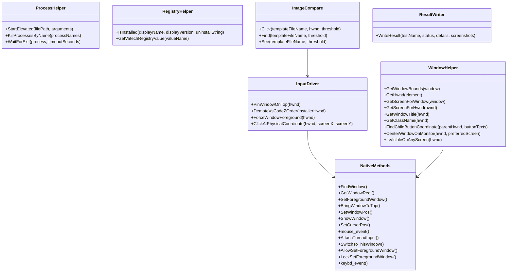

# Ez3D-i.Installer — Core & Infrastructure Graph

Maps low-level drivers, Win32 P/Invoke APIs, Registry scanning, and Reference Template Assets.

---

## 1. Core Component Map

---

## 2. Asset Catalog (`Assets/Templates/`)

Visual reference templates used for calibration and verification:

| Filename | Resolution | Description | Associated Action / Screen |
| :--- | :--- | :--- | :--- |
| **`01_welcome_wizard.png`** | 503×388 | Welcome to InstallShield Wizard page | `StepThroughSetupWizardAction` (Step 1) |
| **`02_license_agreement_unaccepted.png`** | 503×388 | License Agreement page (Default unaccepted, Next disabled) | `StepThroughSetupWizardAction` (Step 2) |
| **`03_license_agreement_accepted.png`** | 503×388 | License Agreement page (Accepted, Next enabled) | `StepThroughSetupWizardAction` (Step 3) |
| **`04_destination_location.png`** | 503×388 | Choose Destination Location (`C:\Program Files\VATECH`) | `StepThroughSetupWizardAction` (Step 4) |
| **`05_ready_to_install.png`** | 503×388 | Ready to Install the Program screen with Install button | `StepThroughSetupWizardAction` (Step 5) |
| **`06_setup_status_progress.png`** | 503×388 | Setup Status with active green file copy progress bar | `WaitForInstallProgressAction` |
| **`07_wizard_complete_finish.png`** | 503×388 | InstallShield Wizard Complete with Finish button | `CompleteInstallationAction` |
| **`btn_next.png`** | 72×24 | Dedicated Next > button template cropped from wizard | `StepThroughSetupWizardAction` (Step 1, 3, 4) |
| **`08_uninstall_confirm_prompt.png`** | 396×141 | Confirmation dialog ("Do you want to completely remove...") | `ConfirmUninstallationAction` (Step 1 / Step 4) |
| **`09_uninstall_complete_finish.png`** | 491×381 | Uninstall Complete dialog with Finish button | `ConfirmUninstallationAction` (Step 3 / Step 5) |
| **`10_maintenance_mode_welcome.png`** | 497×377 | Maintenance Mode Welcome page (Repair default, Remove unselected) | `HandleMaintenanceModeAction` (Step 2) |
| **`11_maintenance_mode_remove_selected.png`** | 499×380 | Maintenance Mode with Remove selected and confirm dialog over it | `HandleMaintenanceModeAction` (Step 3) |
| **`12_upgrade_welcome.png`** | 503×388 | Upgrade Welcome page ("...will update installed version to 5.5.16.0") | `HandleUpgradeWizardAction` (Step 1) |
| **`13_upgrade_status_progress.png`** | 503×388 | Upgrade Setup Status page with active progress bar | `WaitForInstallProgressAction` |
| **`14_upgrade_complete_finish.png`** | 503×388 | Update Complete page ("...has updated Ez3D-i to version 5.5.16.0") | `TC01_InPlace_Upgrade` (Step 3) |
| **`15_quick_setting_dialog.png`** | 500×650 | Quick Setting dialog (1st launch, empty server IP) | `HandleQuickSettingAction` (Step 1) |
| **`16_search_ip_address_dialog.png`** | 500×650 | Searching the IP Address of file server modal dialog | `HandleQuickSettingAction` (Step 3) |
| **`17_search_ip_address_127_selected.png`** | 400×320 | Search dialog with 127.0.0.1 row selected | `HandleQuickSettingAction` (Step 4) |
| **`18_quick_setting_ip_verified.png`** | 500×650 | Quick Setting dialog with 127.0.0.1 populated in Server IP | `HandleQuickSettingAction` (Step 6) |
| **`btn_search.png`** | 254×26 | Dedicated Search button template cropped from Quick Setting dialog | `QuickSettingScreen` / `HandleQuickSettingAction` (Step 2) |
