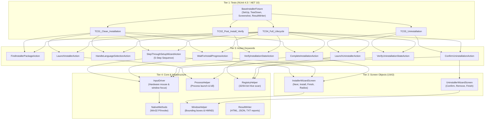

# Ez3D-i.Installer — Code Graph & Architecture Map

Welcome to the **Code Graph** documentation suite for the **Ez3D-i.Installer Test Automation Framework**. This directory serves as a living structural and semantic knowledge graph representing all code entities, execution pipelines, dependency hierarchies, and test coverage maps.

---

## 📌 1. What is the Code Graph?
The **Code Graph** models the installer automation framework as a **directed semantic network**:
- **Nodes**: Classes, methods, test fixtures, UI element locators, and reference image templates.
- **Edges**: Semantic interactions such as `calls`, `inherits_from`, `drives_input`, `asserts`, and `tears_down`.

---

## 🗺️ 2. Code Graph Navigation Index

| Document | Scope & Focus | Key Content |
| :--- | :--- | :--- |
| **[`Architecture_Graph.md`](file:///d:/Ez3D-i.Installer/Code%20Graph/Architecture_Graph.md)** | **System-Wide Tiered Hierarchy** | 4-Tier architecture model, layer boundary rules, and execution lifecycle. |
| **[`Test_To_Action_Map.md`](file:///d:/Ez3D-i.Installer/Code%20Graph/Test_To_Action_Map.md)** | **Test Case Coverage Mapping** | Mapping of TC01–TC04 to consumed Actions, Screens, and Registry keys. |
| **[`Action_Call_Hierarchy.md`](file:///d:/Ez3D-i.Installer/Code%20Graph/Action_Call_Hierarchy.md)** | **Action Call Trees** | Call hierarchies for Discovery, Installation, Progress, Verification, and Uninstallation. |
| **[`Screen_Object_Graph.md`](file:///d:/Ez3D-i.Installer/Code%20Graph/Screen_Object_Graph.md)** | **Screen Object Models** | Locators and control patterns for `InstallerWizardScreen` and `UninstallerWizardScreen`. |
| **[`Core_And_Infrastructure_Graph.md`](file:///d:/Ez3D-i.Installer/Code%20Graph/Core_And_Infrastructure_Graph.md)** | **Infrastructure & Assets Map** | Win32 P/Invoke drivers, UIA3, Registry, and Asset template catalog. |
| **[`Impact_Analysis_Matrix.md`](file:///d:/Ez3D-i.Installer/Code%20Graph/Impact_Analysis_Matrix.md)** | **Reverse Impact Analysis** | Blast-radius assessment and reverse dependency tables for safe refactoring. |

---

## 📐 3. High-Level System Architecture

