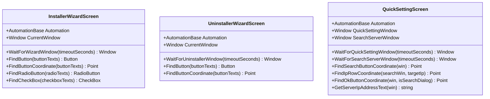

# Ez3D-i.Installer — Screen Object Graph

Detailed Page Object Models for InstallShield and Uninstaller wizard windows.

---

## 1. Class Hierarchy

---

## 2. Window Identification & Locators

### A. `InstallerWizardScreen`
* **Window Criteria:** Class `#32770`, Title containing `"Ez3D-i"`, `"InstallShield"`, or `"Setup"`. Minimum dimensions `200x150`.
* **Button Locators:**
  - `Next >`, `&Next >`, `Next`
  - `Install`, `&Install`
  - `Finish`, `&Finish`
  - `Cancel`
* **Radio Button Locators:**
  - `"accept the terms"`, `"I accept"`, `"accept"`, `"agree"`
  - `"restart my computer later"`
* **Checkbox Locators:**
  - `"Launch"`, `"Ez3D-i"`

### B. `UninstallerWizardScreen`
* **Window Criteria:** Class `#32770`, Title containing `"Ez3D-i"`, `"Uninstall"`, or `"Confirm"`.
* **Button Locators:**
  - `Yes`, `&Yes` (Removal confirmation)
  - `Next >`, `Remove`, `&Remove`
  - `Finish`, `&Finish`, `OK`
