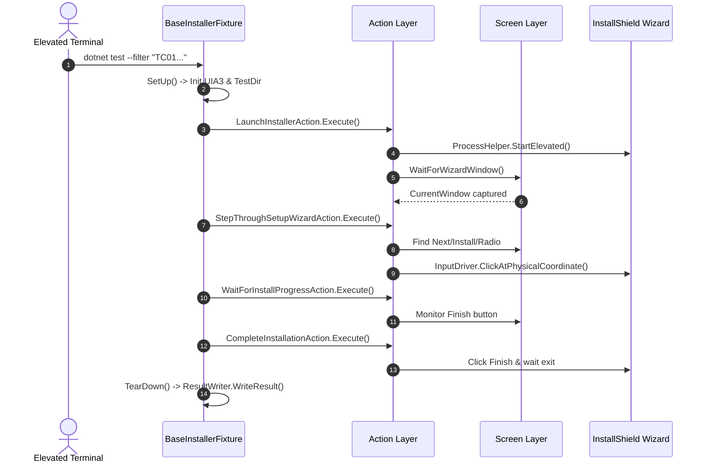

# Ez3D-i.Installer — Test-To-Action Map

This document defines the bipartite mapping between NUnit test fixtures and the Actions / Screens they consume.

---

## 📌 Coverage Matrix

| Test Fixture (in `Tests/Install/`) | Method | Consumed Actions | Consumed Screens | Validation Target |
| :--- | :--- | :--- | :--- | :--- |
| **`TC01_Clean_Installation`** | `Run_TC01_Clean_Installation()` | `EnsureEz3DiUninstalledAction` `FindInstallerPackageAction` `LaunchInstallerAction` `HandleLanguageSelectionAction` `StepThroughSetupWizardAction` `WaitForInstallProgressAction` `CompleteInstallationAction` | `InstallerWizardScreen` `UninstallerWizardScreen` | Clean deployment of Ez3D-i from local package (auto-cleans lingering instance). |
| **`TC02_Post_Install_Verify`** | `Run_TC02_Post_Install_Verify()` | `VerifyInstallationStateAction` | *(None - Filesystem & Registry)* | Binary `Bin\Ez3D-i64.exe`, Desktop Shortcut, Registry Uninstall key. |
| **`TC03_Uninstall_Control_Panel`** | `Run_TC03_Uninstall_Control_Panel()` | `EnsureEz3DiInstalledAction` `LaunchUninstallerAction` `ConfirmUninstallationAction` `VerifyUninstallationStateAction` | `InstallerWizardScreen` `UninstallerWizardScreen` | Control Panel uninstallation via registry UninstallString (auto-deploys if missing). |
| **`TC04_Uninstall_Rerun_Package`** | `Run_TC04_Uninstall_Rerun_Package()` | `EnsureEz3DiInstalledAction` `LaunchInstallerAction` `HandleLanguageSelectionAction` `HandleMaintenanceModeAction` `ConfirmUninstallationAction` `VerifyUninstallationStateAction` | `InstallerWizardScreen` `UninstallerWizardScreen` | Maintenance mode uninstallation by rerunning original setup package (auto-deploys if missing). |
| **`TC05_Full_Lifecycle`** | `Run_TC05_Full_Lifecycle()` | `EnsureEz3DiUninstalledAction` *All Actions (Composite Flow)* | `InstallerWizardScreen` `UninstallerWizardScreen` | End-to-end: Install $\rightarrow$ Verify $\rightarrow$ Uninstall $\rightarrow$ Verify Cleanup (auto-cleans first). |
| **`TC06_Quick_Setting`** | `Run_TC06_Quick_Setting()` | `EnsureEz3DiInstalledAction` `HandleQuickSettingAction` | `QuickSettingScreen` | First-launch Quick Setting: anti-hide past VS Code, Search dialog, 127.0.0.1 IP selection & assertion. |

### Upgrade Suite (`Tests/Upgrade/`)

| Test Fixture | Method | Consumed Actions | Consumed Screens | Validation Target |
| :--- | :--- | :--- | :--- | :--- |
| **`TC01_InPlace_Upgrade`** | `Run_TC01_InPlace_Upgrade()` | `EnsureEz3DiOldVersionInstalledAction` `FindInstallerPackageAction` `LaunchInstallerAction` `HandleLanguageSelectionAction` `HandleUpgradeWizardAction` `WaitForInstallProgressAction` `CompleteInstallationAction` `VerifyInstallationStateAction` | `InstallerWizardScreen` `UninstallerWizardScreen` | In-place version upgrade from baseline older version (v5.5.15.1) to target release (v5.5.16.0) with automated baseline state guard. |

---

## 🔄 Test Execution Lifecycle

