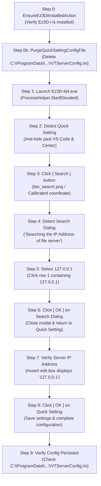

# Test Specification: TC06 Quick Setting (1st Launch Configuration)

## 1. Specification Metadata
- **Suite:** Install Test Suite (`Tests/Install/`)
- **Fixture Class:** `TC06_Quick_Setting.cs`
- **Category:** `[Category("Installation")]`
- **Execution Order:** `[Order(6)]`
- **Target OS:** Windows 10/11 x64 (Elevated Administrator)
- **Target Application:** `C:\Program Files\VATECH\Ez3D-i\Bin\Ez3D-i64.exe`
- **Associated Screen:** `Screens/QuickSettingScreen.cs`
- **Associated Action:** `Actions/Install/HandleQuickSettingAction.cs`

---

## 2. Test Objective
Verify that launching `Ez3D-i` for the first time displays the **Quick Setting** dialog, that the dialog is successfully brought to the foreground and elevated past VS Code despite lacking a Windows Taskbar icon, and that clicking **`[ Search ]`**, selecting **`127.0.0.1`**, and clicking **`[ OK ]`** populates the Server IP Address and saves the configuration.

---

## 3. Preconditions & State Guard
- Ez3D-i must be installed (`EnsureEz3DiInstalledAction`).
- **Administrative Config Purge (Step 0b):** `C:\ProgramData\ewoosoft\common\config\VTServerConfig.ini` must be administratively purged via `HandleQuickSettingAction.PurgeQuickSettingConfigFile()`. Because `C:\ProgramData` is a protected Windows system folder, VS Code / Windows Terminal **must be running as Administrator**.
- Purging this configuration file guarantees that `Ez3D-i` detects an unconfigured server state on startup and unconditionally triggers the Quick Setting dialog.

---

## 4. Test Step Execution Sequence

### Detailed Milestone Screenshots:
1. `TC06_Step1_QuickSettingDisplayed.png` — Quick Setting dialog visible and focused.
2. `TC06_Step2_SearchClicked.png` — Search button clicked.
3. `TC06_Step3_SearchDialogDisplayed.png` — Modal search server dialog visible.
4. `TC06_Step4_127Selected.png` — `127.0.0.1` row selected.
5. `TC06_Step5_SearchOkClicked.png` — Search dialog dismissed via OK.
6. `TC06_Step6_ServerIpVerified.png` — Server IP Address displays `127.0.0.1`.
7. `TC06_Step7_QuickSettingCompleted.png` — Quick Setting dismissed via OK.

---

## 5. Visual Reference Templates
- Dialog Template: `Assets/Templates/15_quick_setting_dialog.png`
- Search Modal: `Assets/Templates/16_search_ip_address_dialog.png`
- Selected IP: `Assets/Templates/17_search_ip_address_127_selected.png`
- Verified IP: `Assets/Templates/18_quick_setting_ip_verified.png`
