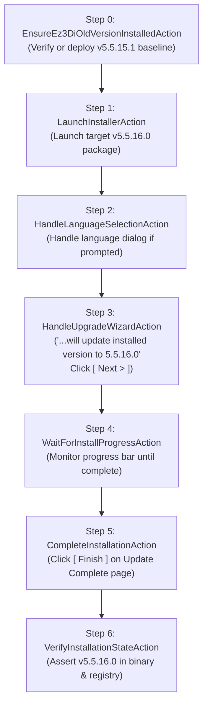

# Test Specification: TC01 In-Place Upgrade (Baseline Old Version $\rightarrow$ Target Release)

## 1. Specification Metadata
- **Suite:** Upgrade Test Suite (`Tests/Upgrade/`)
- **Fixture Class:** `TC01_InPlace_Upgrade.cs`
- **Category:** `[Category("Upgrade")]`
- **Execution Order:** `[Order(1)]`
- **Target OS:** Windows 10/11 x64 (Elevated Administrator)
- **Baseline Package:** `Installation Package/Old Version/Ez3D-i V5.5.15.1 Setup(x64).exe` (v5.5.15.1)
- **Target Release Package:** `Installation Package/Ez3D-i V5.5.16.0 Setup(x64).exe` (v5.5.16.0)

---

## 2. Test Objective
Verify that launching the target release installer (`v5.5.16.0`) against an existing older version installation (`v5.5.15.1`) smoothly executes an in-place version upgrade without requiring manual uninstallation, successfully migrating binaries and updating the Windows Registry to version `5.5.16.0`.

---

## 3. Preconditions & Bilateral State Guard
- **Precondition Check (`EnsureEz3DiOldVersionInstalledAction`):**
  1. Checks if Ez3D-i is currently installed in Windows Registry and filesystem.
  2. If already on the expected baseline version (`DisplayVersion == 5.5.15.1`): Bypasses with 0 overhead.
  3. If currently at `5.5.16.0` or another build: Executes an automated prerequisite uninstallation (`EnsureEz3DiUninstalledAction`) to clear the machine.
  4. Deploys the baseline older package (`Ez3D-i V5.5.15.1 Setup(x64).exe`) via standard clean 5-step installer wizard.
  5. Confirms host is running baseline v5.5.15.1 before proceeding to upgrade testing.

---

## 4. Test Step Execution Sequence

### Detailed Steps:
1. **Step 1 (Launch Target Installer):**
   - Launch `Ez3D-i V5.5.16.0 Setup(x64).exe` with elevated Administrator privileges.
   - Capture screenshot: `TC_UP01_Step1_UpgradeLaunched.png`.
2. **Step 2 (Language Selection):**
   - Detect and confirm language selection dialog (Korean / English) if prompted.
   - Capture screenshot: `TC_UP01_Step2_LanguageHandled.png`.
3. **Step 3 (Upgrade Welcome Page):**
   - Wizard displays: *"The InstallShield Wizard will update the installed version (5.5.15.1) of Ez3D-i to version 5.5.16.0. To continue, click Next."*
   - Click `[ Next > ]` button via physical coordinate mouse click (`InputDriver.ClickAtPhysicalCoordinate`).
   - Capture screenshot: `TC_UP01_Step3_UpgradeWelcome_NextClicked.png`.
4. **Step 4 (Setup Status Progress Bar):**
   - Wizard displays: *"The InstallShield Wizard is updating (5.5.15.1) of Ez3D-i to version 5.5.16.0"*.
   - Monitor active file replacement progress bar until completion (15-minute timeout).
   - Dismiss any prerequisite modal prompts (`#32770`) if displayed.
   - Capture screenshot: `TC_UP01_Step4_SetupProgress.png`.
5. **Step 5 (Update Complete):**
   - Wizard displays: *"The InstallShield Wizard has updated Ez3D-i to version 5.5.16.0."*
   - Click `[ Finish ]` button.
   - Wait for setup process to exit.
   - Capture screenshot: `TC_UP01_Step5_UpgradeCompleted.png`.
6. **Step 6 (Post-Upgrade Verification):**
   - Assert `C:\Program Files\VATECH\Ez3D-i\Bin\Ez3D-i64.exe` exists.
   - Assert `C:\Users\Public\Desktop\Ez3D-i.lnk` exists.
   - Assert Windows Registry `HKLM\SOFTWARE\WOW6432Node\Microsoft\Windows\CurrentVersion\Uninstall\{B3B77B64-AA2E-42CE-A47C-2...}` `DisplayVersion` equals `5.5.16.0`.
   - Capture screenshot: `TC_UP01_Step6_UpgradeVerified.png`.

---

## 5. Visual Reference Templates
- Golden Reference: `Assets/Templates/12_upgrade_welcome.png`
- Progress Status Reference: `Assets/Templates/13_upgrade_status_progress.png`
- Completion Reference: `Assets/Templates/14_upgrade_complete_finish.png`
